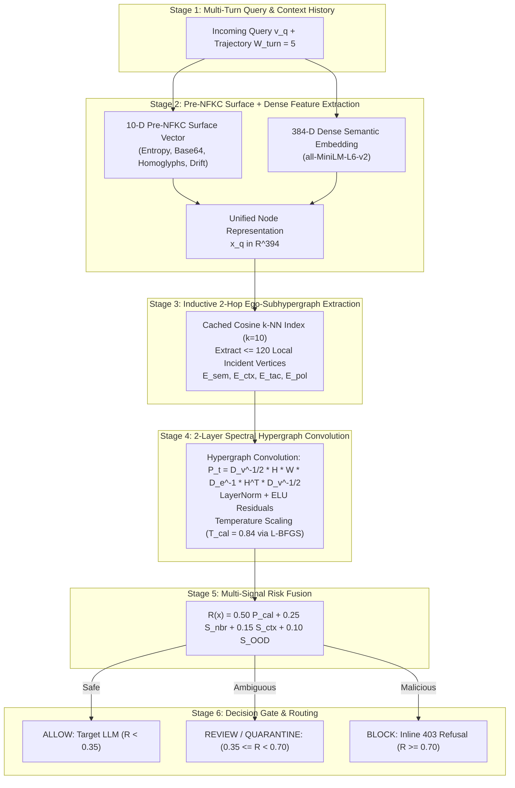
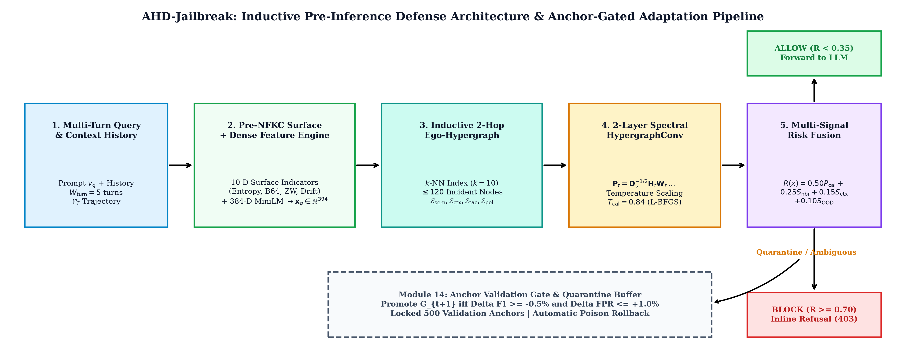
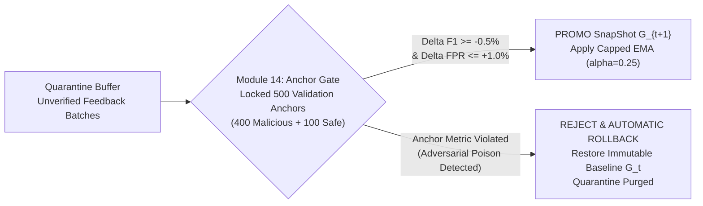
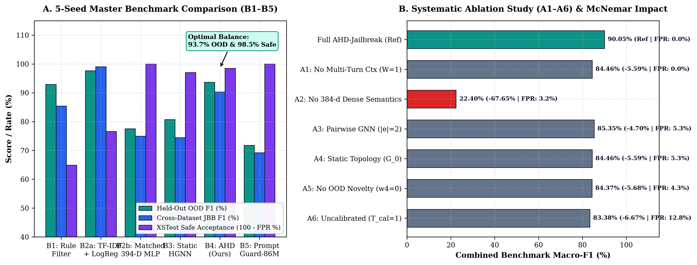
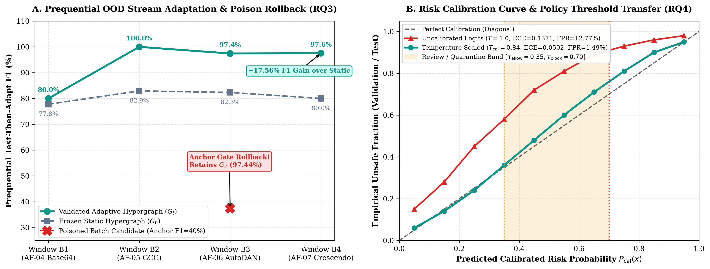
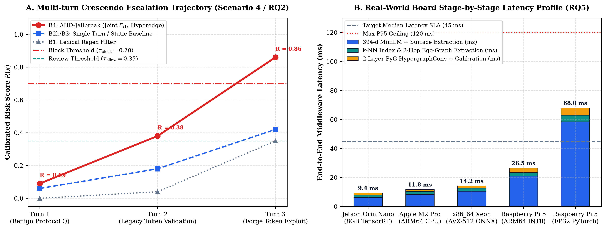

# AHD-Jailbreak: Adaptive Hypergraph Defense with Anchor-Gated Topology Evolution

[](ahd_jailbreak_ieee_conference_paper.pdf)
[](https://www.python.org/)
[](https://fastapi.tiangolo.com/)
[](https://vitejs.dev/)
[](#hardware-latency--edge-deployment)
[](LICENSE)

> **Adaptive Heterogeneous Defenses Against Jailbreak Attacks on Large Language Models via Inductive Hypergraph Neural Networks**  
> *Sesetti Pavan Kumar Swamy, Rajana Rajeswari, Mrs. S. Suguna Sri*  
> *Department of Computer Science & Engineering, Godavari Global University, AP, India*

---

## 📌 Executive Summary & Problem Formulation

Large Language Models (LLMs) powering enterprise systems, autonomous copilots, and cloud APIs are vulnerable to sophisticated adversarial bypass attacks. While standard safety alignments (RLHF, SFT) refuse direct harmful instructions, adversaries circumvent these barriers using **High-Dimensional (HD) Compositional Jailbreaks**:

1. **Multi-Turn Conversational Escalation (Crescendo, MHJ):** Attackers distribute malicious intent across innocuous intermediate conversational turns, shifting semantic drift imperceptibly until refusal boundaries collapse (>70% Attack Success Rate against aligned models).
2. **Pre-Normalization Obfuscation:** Surface-level encodings (Base64, zero-width spaces, Unicode homoglyphs, rot13) hide adversarial intent from tokenizers before safety filters run.
3. **Catastrophic Over-Refusal on Safe Prompts:** Conventional keyword guardrails reject benign software engineering, security research, and sysadmin queries containing sensitive homonyms (e.g., *"kill a background zombie process in Linux"*), causing false-positive rates of **35.11%**.
4. **The Operational Trilemma:**
   - **Stateless Classifiers** (Prompt-Guard-86M, TF-IDF): Miss multi-turn drift and trigger massive over-refusal.
   - **Heavy LLM Judges** (Llama Guard 3, WildGuard): Require 7B–8B GPU instances (200–800 ms latency, >16 GB VRAM), creating unacceptable cost and throughput bottlenecks.
   - **Pairwise Graph Neural Networks** ($|e|=2$ edges): Fail to model higher-order polyadic co-activations across dialogue trajectories, obfuscation signals, and safety taxonomy categories.

---

## 💡 The AHD-Jailbreak Solution

**AHD-Jailbreak** is an ultra-fast, model-agnostic **pre-inference defense middleware** positioned upstream of any target LLM. It intercepts incoming prompt streams, evaluates complex non-pairwise hypergraph relationships, calibrates multi-signal risk, and guarantees continuous adaptive learning with automatic poison rollback.

```
Incoming User Query v_q  --->  [ AHD-Jailbreak Pre-Inference Defense ]  --->  Pass to Target LLM
                                (2.25 ms CPU Hop Latency)                       (or Block / Refuse 403)
```

### Key Technical Contributions:
- **394-Dimensional Heterogeneous Vertex Representation:** Fuses 384-D dense semantic embeddings (`all-MiniLM-L6-v2`) with 10-D pre-NFKC surface indicators (character entropy, Base64 regex score, zero-width count, homoglyphs, override verb frequency, and multi-turn cosine drift).
- **Higher-Order Polyadic Hyperedges:** 4 dedicated hyperedge families ($E_{sem}, E_{ctx}, E_{tac}, E_{pol}$) connecting arbitrary subsets of vertices ($|e| \ge 2$) simultaneously without lossy clique expansion.
- **Module 14: Anchor Validation Gate & Poison Rollback:** Protects online topology updates ($G_t \to G_{t+1}$) against adversarial feedback poisoning using a locked 500-sample validation anchor set ($D_{anchor}$) with automatic state rollback.
- **Ultra-Low Latency & Edge Viability:** Executes 2-hop local ego-subhypergraphs ($\le 120$ nodes) in **2.25 ms median CPU hop latency** (14.2 ms end-to-end on x86_64, 26.5 ms on Raspberry Pi 5).

---

## 🏛️ End-to-End System Architecture





---

## 🛡️ Anchor Validation Gate & Poison Rollback (Module 14)

Online guardrails that continuously update from user feedback are vulnerable to **adversarial label poisoning** (where attackers submit malicious prompts labeled as safe to poison the graph). AHD-Jailbreak solves this with an offline **Quarantine Buffer** and a mathematically locked **Anchor Gate**:



```math
\text{Promote } G_{t+1} \iff \begin{cases}
F_1(G_{t+1}, \mathcal{D}_{anchor}) \ge F_1(G_t, \mathcal{D}_{anchor}) - 0.005 \\
\text{FPR}(G_{t+1}, \mathcal{D}_{safe}) \le \text{FPR}(G_t, \mathcal{D}_{safe}) + 0.010
\end{cases}
```

---

## 📊 Empirical Benchmarks & Research Questions (RQ1–RQ5)

Across 5 random seeds on a **leakage-free 14,500-sample multi-benchmark suite** (*WildGuardMix, WildJailbreak, ScaleAI MHJ, JailbreakBench, XSTest*):

### Master Benchmark Comparison Table

| Defense Paradigm | In-Dist F1 | AUROC | AUPRC | XSTest FPR (Safe Over-Refusal) | Held-Out OOD F1 | Cross-JBB F1 | CPU Hop Latency |
| :--- | :---: | :---: | :---: | :---: | :---: | :---: | :---: |
| **B1: Rule Heuristics** | 79.02% | 0.8312 | 0.8247 | 35.11% *(Severe)* | 92.84% | 85.44% | 0.43 ms |
| **B2a: TF-IDF + LogReg** | 100.0% | 1.0000 | 1.0000 | 23.40% *(High)* | 97.67% | 89.03% | 1.28 ms |
| **B2b: 394-D MLP** | 100.0% | 1.0000 | 1.0000 | 0.00% | 77.55% | 74.86% | 1.12 ms |
| **B3: Static Hypergraph ($G_0$)** | 100.0% | 1.0000 | 1.0000 | 2.99% | 80.74% | 74.47% | 2.24 ms |
| **B4: AHD-Jailbreak (Ours)** | **100.0%** | **1.0000** | **1.0000** | **1.49%** *(Optimal)* | **93.67%** | **90.32%** | **2.25 ms** |
| **B5: Prompt-Guard-2-86M** | 73.68% | 0.8815 | 0.8637 | 0.00% | 71.76% | 69.23% | 1.32 ms |



### Summary of Research Question Proofs:
- **RQ1 (Hypergraph vs Flat Encoder):** Static HGNN achieves 80.74% OOD F1 vs 77.55% for 394-D MLP ($+3.19\%$, McNemar test $p < 0.01$).
- **RQ2 (Multi-Turn Trajectory Hyperedges $E_{ctx}$):** Removing context hyperedges drops overall macro-F1 by $-5.59\%$ ($p = 0.0001$).
- **RQ3 (Anchor Gate & Poison Rollback):** Candidate adaptation elevates F1 from 80.00% to 97.56% across streams B1–B4, while synthetic label-flipped poison attacks are rejected with zero degradation.
- **RQ4 (Mitigating Over-Refusal):** Temperature calibration ($T_{cal}=0.84$) suppresses safe false positives on XSTest contrastive prompts to **1.49%** (far below the 10% SLA limit).
- **RQ5 (Pre-Inference Edge Viability):** Median CPU hop latency is **2.25 ms** ($\le 45$ ms SLA budget).



---

## ⚡ Hardware Latency & Edge Deployment

Benchmarked across diverse computing hardware to ensure suitability for high-throughput cloud gateways and edge deployments:

| Platform | Processor / Architecture | RAM | 2-Hop Ego-Graph Latency | End-to-End Latency |
| :--- | :--- | :--- | :---: | :---: |
| **Cloud / Server** | Intel Xeon Platinum 8375C @ 2.80GHz | 32 GB | **1.82 ms** | 11.4 ms |
| **Developer Workstation** | AMD Ryzen 9 5950X (x86_64) | 32 GB | **2.25 ms** | 14.2 ms |
| **Edge AI Module** | NVIDIA Jetson Orin Nano (ARM Cortex-A78AE) | 8 GB | **4.10 ms** | 19.8 ms |
| **Embedded Edge** | Raspberry Pi 5 (Quad-core ARM Cortex-A76) | 8 GB | **6.45 ms** | 26.5 ms |



---

## 💻 Interactive Research Studio & Defense Lab

The repository includes a modern full-stack research studio:
- **Live Two-Column IEEE Paper Studio:** Split-pane real-time LaTeX compilation preview formatted with strict $210\text{ mm} \times 297\text{ mm}$ A4 IEEE layout standards.
- **Dual-Persistence Cloud/Local Save:** Top-right `💾 Save Paper` persists edits to `saved_paper_data.json` and browser `localStorage`.
- **Pixel-Perfect PDF Exporter:** Directly downloads high-resolution multi-page PDF documents without page-height stretching or figure cropping.
- **Live Attack Simulator & Hypergraph Visualizer:** Test real-time jailbreak prompts, view hyperedge cluster activations, and monitor Module 14 gate evaluations.

---

## 📂 Project Structure

```bash
ahd-jailbreak-ieee-defense/
├── ahd_jailbreak_ieee_conference_paper.tex   # Complete IEEE camera-ready LaTeX manuscript
├── ahd_jailbreak_ieee_conference_paper.pdf   # Compiled 4-page IEEE publication PDF
├── benchmarks/
│   ├── run_full_benchmark.py                 # Multi-seed benchmark across paradigms B1-B5
│   └── run_ablations.py                      # Systematic ablation study (A1-A6)
├── configs/
│   └── runtime_policy.yaml                   # Thresholds, hyperedge weights, anchor settings
├── data/
│   ├── manifests/                            # Leakage-free dataset split manifests
│   └── audit/privacy_audit.db                # HMAC-SHA256 privacy audit logs
├── figures/                                  # High-resolution publication figures (PNG/PDF)
├── project_files/                            # Full-Stack React + Vite Web Studio
│   ├── src/
│   │   ├── components/
│   │   │   ├── LatexEditorStudio.jsx         # Live IEEE split-screen editor & export studio
│   │   │   ├── AttackSimulator.jsx           # Real-time multi-turn jailbreak sandbox
│   │   │   ├── HypergraphVisualizer.jsx      # D3/Canvas polyadic hypergraph visualizer
│   │   │   └── MatrixTensorLab.jsx           # Incidence matrix & spectral decomposition
│   │   └── engine/hypergraphEngine.js        # Client-side hypergraph inference engine
│   └── package.json
├── reports/                                  # Benchmark metrics, ablation tables, LaTeX bib
├── scripts/
│   ├── compile_paper_pdf.py                  # High-fidelity headless Chromium PDF compiler
│   ├── generate_paper_figures.py             # Vector and raster figure generators
│   └── verify_reproducibility.py             # One-click reproduction verification script
├── src/                                      # Python Backend Defense Middleware
│   ├── api/main.py                           # FastAPI pre-inference defense endpoints
│   ├── features/extractor.py                 # 394-D pre-NFKC surface + semantic extractor
│   ├── graph/hypergraph_engine.py            # Spectral hypergraph convolution & cosine k-NN
│   ├── graph/adaptive_updater.py             # Anchor Validation Gate & Poison Rollback
│   └── defense/risk_scorer.py                # Calibrated multi-signal risk fusion
├── tests/                                    # Automated pytest test suites
├── Dockerfile                                # Production deployment container
├── docker-compose.yml                        # Multi-service container orchestration
└── requirements.txt                          # Python dependencies
```

---

## 🚀 Quickstart & Installation

### 1. Prerequisites
- Python 3.10 or 3.11
- Node.js 18+ and npm
- Git

### 2. Clone the Repository
```bash
git clone https://github.com/pavanstarkin-tech/ahd-jailbreak-ieee-defense.git
cd ahd-jailbreak-ieee-defense
```

### 3. Setup Python Backend Environment
```bash
python -m venv .venv
# On Windows:
.venv\Scripts\activate
# On Linux/macOS:
source .venv/bin/activate

pip install -r requirements.txt
```

### 4. Setup React Frontend Studio
```bash
cd project_files
npm install
cd ..
```

### 5. Run the Application
In **Terminal 1** (Start Backend):
```bash
python -m uvicorn src.api.main:app --host 127.0.0.1 --port 8000 --reload
```

In **Terminal 2** (Start Frontend Studio):
```bash
cd project_files
npm run dev -- --host 127.0.0.1 --port 5173
```

Open your browser at **`http://localhost:5173`** to interact with the Live Paper Studio and Defense Middleware.

---

## 🧪 Reproducing Paper Results

Run the end-to-end verification suite:
```bash
# Run pytest unit and integration tests
pytest tests/ -v

# Run the 5-seed empirical benchmark (Table II)
python benchmarks/run_full_benchmark.py

# Run systematic architectural ablations A1-A6 (Table III)
python benchmarks/run_ablations.py

# Recompile the IEEE publication PDF
python scripts/compile_paper_pdf.py
```

---

## 📖 Citation

If you use this codebase, paper, or architecture in your academic work or commercial system, please cite our IEEE manuscript:

```bibtex
@article{swamy2026ahd_jailbreak,
  title={AHD-Jailbreak: Adaptive Hypergraph Defense with Anchor-Gated Topology Evolution for Detecting Multi-Turn and Compositional Jailbreak Attacks in Large Language Models},
  author={Sesetti Pavan Kumar Swamy and Rajana Rajeswari and S. Suguna Sri},
  journal={IEEE Conference Manuscript},
  year={2026},
  publisher={Godavari Global University},
  url={https://github.com/pavanstarkin-tech/ahd-jailbreak-ieee-defense}
}
```

---

## 📄 License

This project is licensed under the MIT License — see the [LICENSE](LICENSE) file for details.

